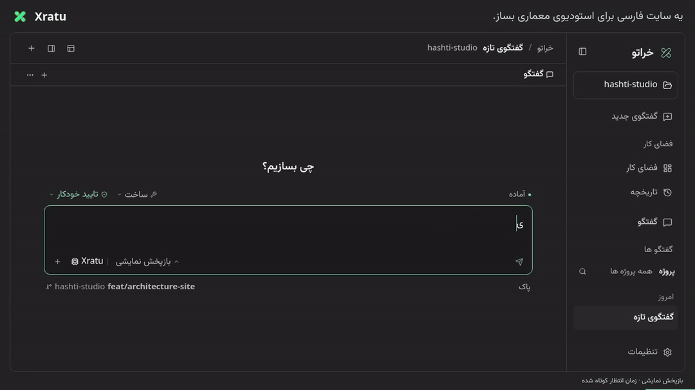

# خراتو

<p align="center">
  
</p>

<p align="center">
  <a href="README.md">English</a> ·
  <a href="#خراتو">فارسی</a>
</p>

<p align="center">
  <a href="https://github.com/thesamehosuh/xratu/actions/workflows/ci.yml"></a>
  <a href="LICENSE"></a>
  
</p>

ایجنت کدنویسی هوش مصنوعی متن باز برای `VS Code`. با مدل های رایگان `OpenCode` شروع کن، کلید API یا اشتراک `ChatGPT` خودت رو وصل کن، یا مدل ها رو محلی روی سیستمت اجرا کن؛ با رابط کامل فارسی و انگلیسی.

<p align="center">
  <a href="assets/brand/xratu-showcase-fa.mp4"></a>
</p>

## شروع به کار

[خراتو رو از فروشگاه `VS Code` نصب کن](https://marketplace.visualstudio.com/items?itemName=xratu.xratu). برای نصب دستی، آخرین فایل `.vsix` رو از [نسخه ها](https://github.com/thesamehosuh/xratu/releases) بگیر و توی `VS Code` گزینه **`Extensions → ⋯ → Install from VSIX…`** رو بزن.

۱. پوشه پروژه رو توی `VS Code` باز کن، بعد خراتو رو از نوار کناری باز کن.
۲. یکی از مسیرهای **شروع رایگان**، **سرویس خودم** یا **مدل محلی** رو انتخاب کن.
۳. یه مدل انتخاب کن، **شروع گفتگو** رو بزن و بگو چی میخوای بسازی یا درست کنی.

| مسیر | چی لازم داری |
|------|--------------|
| **شروع رایگان** | خراتو با یه کلیک `OpenCode 2` رو برات نصب میکنه. در دسترس بودن مدل های رایگان و سقف درخواست ها دست `OpenCode` هست. |
| **سرویس خودم** | کلید API ابری بزن، با اشتراک `ChatGPT` وارد شو، یکی از سرویس های ایرانی رو انتخاب کن یا یه نشانی دلخواه سازگار با `OpenAI` وارد کن. |
| **مدل محلی** | `Ollama`، `LM Studio`، `vLLM` یا `llama.cpp` رو با یه مدل آماده اجرا کن (مدل های `Ollama` رو مستقیم از داخل خراتو هم میتونی دانلود کنی). |

هر وقت خواستی اتصالت رو عوض کنی به **تنظیمات ← ارائه دهنده ها** برو، و برای انتخاب موتور گفتگوی تازه **تنظیمات ← موتورهای اجرا** رو باز کن.

## چه کارهایی میتونی بکنی

- **کدنویسی و اشکال زدایی روی کل پروژه**: خوندن فایل ها، ویرایش کد، اجرای دستور ترمینال، پیوست عکس، PDF و ارجاع `@` به فایل ها، و هدایت ایجنت وسط کار. توی حالت **برنامه** میتونی فقط بررسی و برنامه ریزی کنی و هر تغییری توی کد مسدوده.
- **بررسی دقیق هر تغییر**: تفاوت فایل ها رو توی **تغییرات** ببین و روی هر فایل یادداشت بذار، خروجی کامل ابزارها رو توی **فعالیت** دنبال کن، دستورهای طولانی رو توی **پس زمینه** ببین و هر وقت خواستی از نقطه های بازیابی برگرد.
- **کار با زیرعامل ها**: پژوهش، تست یا ویرایش رو به گفتگوهای فرعی موازی توی **ایجنت ها** بسپار؛ با پروفایل های داخلی (`explore`، `verify`، `general`) یا فایل های `.md` خودت. میتونی وسط کار پیام بفرستی، تاییدهای هر کدوم رو جدا بدی یا تکی متوقفش کنی. [راهنمای زیرعامل ها](docs/guide.fa.md#زیرعامل-ها).
- **مرورگر مشترک زنده**: سایت یا سرور محلی توسعه رو توی تب **مرورگر** باز کن تا خودت و ایجنت همزمان روی یه صفحه کار کنین؛ با اسکرین شات، بررسی خطاهای صفحه و کلیک و تایپ زنده.
- **دانلود فایل و پیگیری PR**: دانلودهای قابل ادامه و باز کردن امن فایل های فشرده رو توی **دانلود ها** ببین ([راهنما](docs/guide.fa.md#دانلود-ها-و-فایل-های-فشرده)) و وضعیت بررسی ها، تست ها و نظرهای PR های گیت هاب رو توی **درخواست ادغام** دنبال کن ([راهنما](docs/guide.fa.md#درخواست-های-ادغام)).
- **گسترش با MCP و مهارت ها**: سرورهای MCP از نوع `stdio`، `WebSocket` یا `HTTP/SSE` رو از **فروشگاه** داخلی یا فایل JSON وصل کن، و مهارت های استاندارد `SKILL.md` رو بین خراتو، `Claude Code`، `OpenCode` و ابزارهای دیگه مشترک نگه دار.
- **ساخته شده برای فارسی و ایران**: رابط راست به چپ فارسی، تاریخ جلالی، پاسخ فارسی طبیعی، سرویس های ایرانی با محاسبه هزینه به تومان، تشخیص خودکار پروکسی سیستم کلاینت های Clash و v2rayN (بدون نیاز به TUN)، و سرورهای MCP ایرانی منتخب.

## دو موتور در یه فضای کار

- **موتور داخلی خراتو** با سرویس های ابری، سرویس های ایرانی، اشتراک `ChatGPT` و مدل های محلی کار میکنه؛ با پشتیبانی کامل از پروفایل های سفارشی زیرعامل، برگردوندن گفتگو و **حالت آفلاین**.
- **`OpenCode 2`** مدل های رایگان و نشست ها، ابزارها و زیرعامل های بومی خودش رو میاره توی فضای کار خراتو و از سرورهای MCP، مهارت های فعال، مرورگر، دانلودها و فهرست کارهای خراتو استفاده میکنه، در حالی که اطلاعات ورود خودش رو جدا نگه میداره.

مقایسه کامل رو توی [راهنمای موتورهای اجرا](docs/guide.fa.md#موتورهای-اجرا) ببین.

## تایید کارها و حریم خصوصی

- **حالت با تایید به شکل پیش فرض**: ویرایش فایل، دستور ترمینال، کارهای مرورگر و ابزارهای MCP قبل از اجرا ازت تایید میگیرن. اگه اجرای بدون وقفه میخوای میتونی توی کادر پیام **YOLO** رو روشن کنی؛ حالت **برنامه** همیشه تغییرات رو مسدود میکنه.
- **نقطه های بازیابی جداگانه**: اسنپ شات های خودکار قبل از ویرایش توی فضای گیت جداگانه ذخیره میشن و هیچ وقت به مخزن و تاریخچه گیت پروژه ات دست نمیزنن.
- **محلی و بدون ردیابی**: هیچ تله متری، آمارگیری یا گزارش کرشی وجود نداره. تاریخچه گفتگوها و نقطه های بازیابی روی دیسک خودت میمونن، کلیدهای API توی `SecretStorage` خود `VS Code` ذخیره میشن و **حالت آفلاین** ترافیک خراتو رو به مدل های محلی همین سیستم محدود میکنه. [جزئیات حریم خصوصی](docs/guide.fa.md#حریم-خصوصی-و-امنیت).

## راهنماها

- [راهنمای کامل](docs/guide.fa.md) — پنل های فضای کار، موتورهای اجرا، زیرعامل ها، مرورگر، دانلودها، درخواست های ادغام، MCP، مهارت ها، پروکسی و تنظیمات
- [راهنمای حالت آفلاین و مدل محلی](assets/guides/offline.fa.md) — `Ollama`، `LM Studio`، انتخاب اندازه مدل و حالت آفلاین
- [مقایسه ارائه دهنده ها](assets/guides/providers.fa.md) — سرویس های ایرانی، نکات پرداخت و سنجش سرعت و هزینه
- [گزارش مشکل](https://github.com/thesamehosuh/xratu/issues) · [سیاست امنیتی](SECURITY.md)

## مشارکت

```bash
npm ci
npm run compile
```

راهنمای توسعه، دستورهای تست و شرایط PR توی [AGENTS.md](AGENTS.md) هست.

[Apache-2.0](LICENSE)
