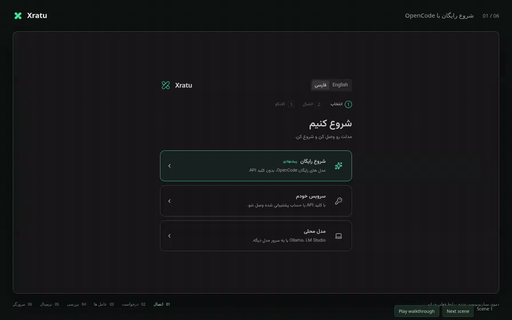

# خراتو

<p align="center">
  
</p>

<p align="center">
  <a href="README.md">English</a> ·
  <a href="#خراتو">فارسی</a>
</p>

<p align="center">
  <a href="https://github.com/thesamehosuh/xratu/actions/workflows/ci.yml"></a>
  <a href="LICENSE"></a>
  
</p>

ایجنت کدنویسی هوش مصنوعی متن باز برای `VS Code`. با مدل های رایگان `OpenCode`،
کلید API خودت یا یه مدل محلی کار کن. رابط برنامه فارسی و انگلیسی داره.

<p align="center">
  
</p>

## شروع به کار

[خراتو رو از فروشگاه `VS Code` نصب کن](https://marketplace.visualstudio.com/items?itemName=xratu.xratu).
برای نصب دستی، فایل `.vsix` رو از [نسخه ها](https://github.com/thesamehosuh/xratu/releases)
بگیر و توی `VS Code` گزینه **`Extensions → ⋯ → Install from VSIX…`** رو بزن.

۱. پوشه پروژه رو توی `VS Code` باز کن، بعد خراتو رو از نوار کناری باز کن.
۲. یکی از مسیرهای **شروع رایگان**، **سرویس خودم** یا **اجرای محلی** رو انتخاب کن.
۳. یه مدل انتخاب کن، **شروع گفتگو** رو بزن و بگو چی میخوای بسازی یا درست کنی.

| مسیر | چی لازم داری |
|------|--------------|
| **شروع رایگان** | خراتو میتونه `OpenCode` 2 رو نصب کنه. در دسترس بودن مدل های رایگان و محدودیت درخواست به `OpenCode` بستگی داره. |
| **سرویس خودم** | به سرویس خودت وصل شو؛ سرویس های ایرانی و اندپوینت دلخواه سازگار با `OpenAI` هم پشتیبانی میشن. |
| **اجرای محلی** | `Ollama`، `LM Studio`، `vLLM` یا `llama.cpp` رو با یه مدل آماده اجرا کن. |

برای تغییر اتصال، **تنظیمات ← ارائه دهنده ها** رو باز کن. برای انتخاب موتور
گفتگوی تازه، به **تنظیمات ← موتورهای اجرا** برو.

## چه کارهایی میتونی بکنی

- از ایجنت بخواه کد رو بخونه، فایل ها رو ویرایش کنه، دستور اجرا کنه و دنبال مشکل بگرده.
- با **حالت برنامه ریزی** بررسی و برنامه ریزی کن؛ تغییرات توی این حالت مسدودن.
- عکس، PDF یا کد پیوست کن و وسط کار مسیر ایجنت رو عوض کن.
- تفاوت فایل ها رو توی **تغییرات**، خروجی کامل رو توی **فعالیت** و دستورهای
  در حال اجرا رو توی **پس زمینه** ببین. هر وقت لازم شد، فایل ها رو از چک پوینت برگردون.
- از ایجنت بخواه فایل دانلود کنه و پیشرفتش رو توی **دانلود ها** ببین. دانلود های
  قطع شده قابل ادامه هستن و اتصال مستقیم یا پروکسی تنظیم شده رو پشتیبانی میکنن. [جزئیات](docs/downloads.md).
- با ایجنت توی **مرورگر** مشترک کار کن یا با **MCP**، **مهارت ها** و **ایجنت ها**
  ابزار و روش کار دلخواهت رو اضافه کن.

موتور خود `Xratu` از مدل محلی، زیرعامل ها و برگردوندن گفتگو پشتیبانی میکنه.
`OpenCode` از سرورهای MCP، فروشگاه، مرورگر، فهرست کارها و مهارت های فعال
`Xratu` استفاده میکنه و اتصال ها و نشست های خودش رو جدا نگه میداره. زیرعامل های بومی
توی بخش ایجنت ها با روند زنده کار و مشخصات تایید ها و سوال هاشون دیده میشن؛ هر
زیرعامل رو جدا میشه متوقف کرد و توقف، زیرعامل های تودرتو و پس زمینه رو هم متوقف
میکنه. اجرا تا رسیدن گزارش همه اون ها فعال
میمونه. واگذاری توی حالت Plan، برگردوندن گفتگو و حالت آفلاین توی OpenCode در دسترس نیستن.

## تایید کارها و حریم خصوصی

حالت YOLO به صورت پیش فرض روشنه و روی ایجنت اصلی و زیرعامل ها اعمال
میشه. برای گرفتن تایید قبل از تغییر، توی کادر پیام خاموشش کن؛ انتخابت ذخیره
میشه. چک پوینت ها توی فضای جداگانه گیت
ذخیره میشن و تاریخچه و مرحله بندی گیت پروژه رو دست نمیزنن.

کلیدهای API مدل توی مخزن امن `VS Code` نگه داشته میشن. مقادیر هدر و محیط MCP
موقع ذخیره به ارجاع امن تبدیل میشن؛ JSON دستی MCP ممکنه هنوز اطلاعات محرمانه
داشته باشه. تاریخچه گفتگو و چک پوینت ها روی سیستم خودت میمونن. درخواست ها و محتوای مرتبط برای سرویس انتخابی فرستاده
میشن؛ پژوهش وب خودکار از Parallel بدون کلید و مسیر جایگزین Exa استفاده میکنه.
سرورهای MCP هم به سرویس تنظیم شده وصل میشن. افزونه
داده آماری جمع نمیکنه. برای کار محلی، یه مدل محلی انتخاب کن و **حالت آفلاین**
رو روشن کن؛ دستورهای ترمینال همچنان محدود نمیشن.

## راهنمای بیشتر

- [راهنمای کامل](docs/guide.fa.md): `OpenCode`، چک پوینت، مرورگر، MCP، مهارت ها، زیرعامل ها و پروکسی.
- [مدل محلی و سخت افزار](assets/guides/offline.fa.md).
- [مقایسه سرویس ها](assets/guides/providers.fa.md)، از جمله سرویس های ایرانی.
- [گزارش مشکل](https://github.com/thesamehosuh/xratu/issues) یا [گزارش مشکل امنیتی](SECURITY.md).

## مشارکت

```bash
npm ci
npm run compile
```

روش توسعه، بررسی تغییرات و شرایط PR توی [AGENTS.md](AGENTS.md) هست.

[Apache-2.0](LICENSE)
