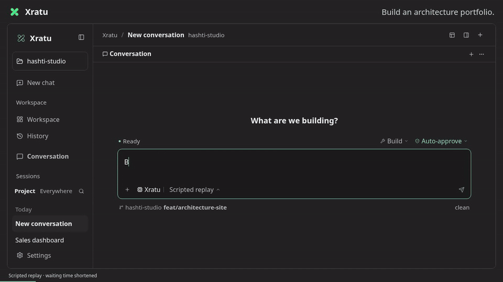

# Xratu

<p align="center">
  
</p>

<p align="center">
  <a href="#xratu">English</a> ·
  <a href="README.fa.md">فارسی</a>
</p>

<p align="center">
  <a href="https://github.com/thesamehosuh/xratu/actions/workflows/ci.yml"></a>
  <a href="LICENSE"></a>
  
</p>

An open-source AI coding agent for VS Code. Start with free OpenCode models, connect your own API key or ChatGPT subscription, or run models locally — in English and Persian.

<p align="center">
  <a href="assets/brand/xratu-showcase.mp4"></a>
</p>

## Get started

Install [Xratu from the VS Code Marketplace](https://marketplace.visualstudio.com/items?itemName=xratu.xratu). For a manual install, download the latest `.vsix` from [Releases](https://github.com/thesamehosuh/xratu/releases) and choose **Extensions → ⋯ → Install from VSIX…**.

1. Open your project folder in VS Code, then open Xratu from the activity bar.
2. Pick **Start free**, **Use my provider**, or **Run locally**.
3. Choose a model, click **Start chat**, and describe what you want to build or fix.

| Setup path | What you need |
|------------|---------------|
| **Start free** | Xratu installs OpenCode 2 for you with one click. Free model availability and rate limits are managed by OpenCode. |
| **Use my provider** | Connect a cloud API key, sign in with a ChatGPT subscription, pick an Iranian gateway, or enter any OpenAI-compatible endpoint. |
| **Run locally** | Start Ollama, LM Studio, vLLM, or llama.cpp with a model loaded (Ollama models can be downloaded inside Xratu). |

You can switch connections anytime under **Settings → Providers** and pick the engine for new conversations under **Settings → Engines**.

## What you can do

- **Build and debug across your repo**: Read files, edit code, run terminal commands, attach images, PDFs, or `@` file references, and steer the agent mid-turn. Switch to **Plan** mode to explore and plan with edits and commands blocked in code.
- **Review every change**: Inspect inline diffs and leave file notes in **Changes**, trace full tool output in **Activity**, monitor long-running commands in **Background**, and roll back anytime from shadow-git checkpoints.
- **Work with subagents**: Delegate research, verification, or edits to parallel child conversations in **Agents** using built-in profiles (`explore`, `verify`, `general`) or your own `.md` agent files — send follow-ups, answer scoped approvals, or stop any child independently. [Subagents guide](docs/guide.md#subagents).
- **Share a live browser**: Open a website or local dev server in the **Browser** tab so you and the agent work on the same page, with screenshots, DOM/console inspection, and live interaction.
- **Manage downloads and PRs**: Follow resumable file downloads and safe archive extraction in **Downloads** ([guide](docs/guide.md#downloads-and-archives)), and track GitHub pull request checks, reviews, and comments in **Pull requests** ([guide](docs/guide.md#pull-requests)).
- **Extend with MCP and Skills**: Connect stdio, WebSocket, or HTTP/SSE MCP servers from the built-in **Marketplace** or JSON config, and share open `SKILL.md` skills with Claude Code, OpenCode, and other tools.
- **Built for Persian and Iranian workflows**: Full RTL Persian UI, Jalali dates, natural Persian replies, first-class Iranian AI gateways with Toman cost tracking, automatic Clash/v2rayN system-proxy detection (no TUN needed), and curated Iranian MCP servers.

## Two engines, one workspace

- **Xratu (built-in)** runs your cloud providers, Iranian gateways, ChatGPT subscription, or local models — with full support for custom agent profiles, conversation rewind, and **Offline mode**.
- **OpenCode 2** brings free models and OpenCode's native sessions, tools, and subagents into Xratu's workspace, sharing your Xratu MCP servers, enabled skills, browser, downloads, and task list while keeping OpenCode credentials separate.

See the [engines guide](docs/guide.md#engines) for the full comparison.

## Approvals and privacy

- **Ask first by default**: File edits, terminal commands, browser actions, and MCP tools ask for approval before running. Switch to **YOLO** in the composer when you want uninterrupted runs; **Plan** mode always blocks mutations.
- **Shadow checkpoints**: Automatic snapshots before edits live in separate shadow-git storage and never touch your repository's git index or history.
- **Local by design**: No telemetry, analytics, or crash reporting. Chat history and checkpoints stay on your disk, API keys stay in VS Code SecretStorage, and **Offline mode** restricts Xratu-managed traffic to loopback local models. [Full privacy details](docs/guide.md#privacy).

## Documentation

- [Full user guide](docs/guide.md) — workspace panels, engines, subagents, browser control, downloads, pull requests, MCP, skills, proxy routing, and settings
- [Offline setup and local models](assets/guides/offline.en.md) — Ollama, LM Studio, hardware sizing, and offline mode
- [Provider comparison](assets/guides/providers.en.md) — Iranian gateways, payment notes, and latency/cost checks
- [Report a bug](https://github.com/thesamehosuh/xratu/issues) · [Security policy](SECURITY.md)

## Contributing

```bash
npm ci
npm run compile
```

See [AGENTS.md](AGENTS.md) for development setup, verification commands, and PR guidelines.

[Apache-2.0](LICENSE)
